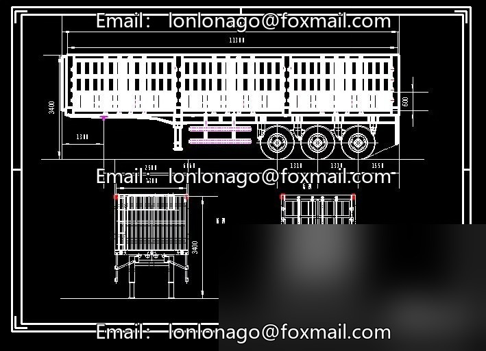
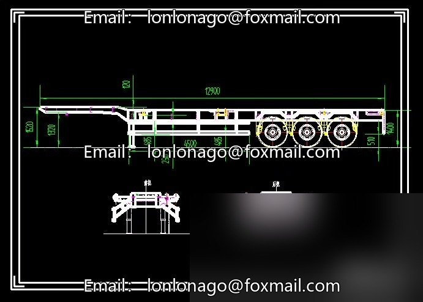
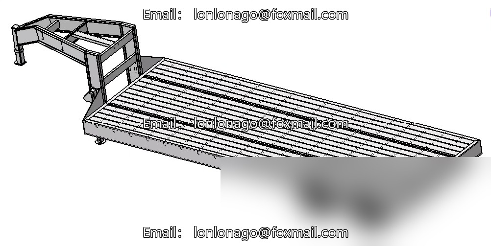
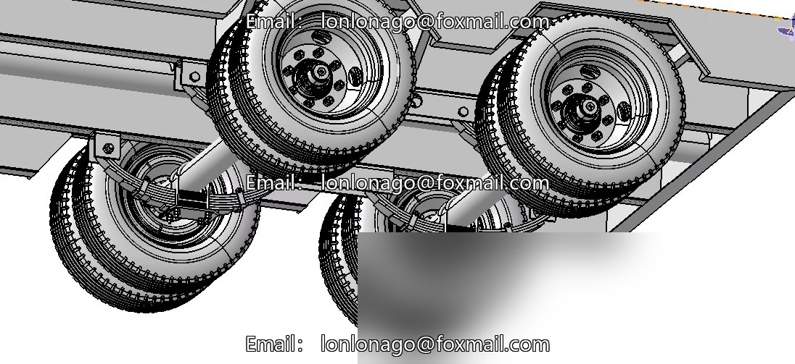

# Half trailer CAD three-dimensional and two-dimensional design

## Body

Semi-trailer CAD 3D and 2D design; semi-trailer CAD 3D and 2D design; cab-mounted semi-trailer CAD 3D and 2D design; semi-trailer 3D and 2D diagram; flat-bottom semi-trailer CAD 3D and 2D design; goose-neck semi-trailer 3D and 2D diagram
Additionally, half-trailer, sample models, etc. can be opened for editing using Catia UG SolidWorks and other software.
A006 Includes services such as modeling and model-data modification, will discuss in detail.

The image shows semi-trailer CAD design drawings, three-dimensional and two-dimensional diagrams, including different models and size identifiers.

<!-- AI_ENRICHED -->

## Images

## Payment

Here is a pay link on Stripe ( https://buy.stripe.com/3cs8yP7sY87d0vu9AB ). Please contact me lonlonago@foxmail.com after funding $89, and I will send you a complete data files , thank you!

